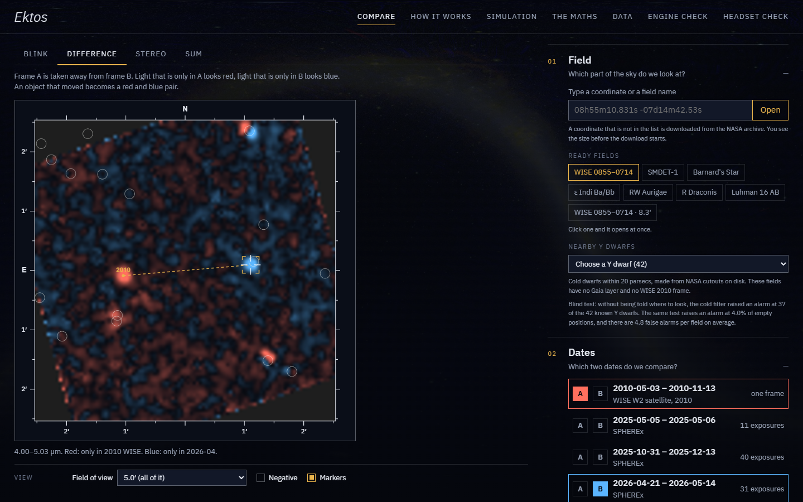
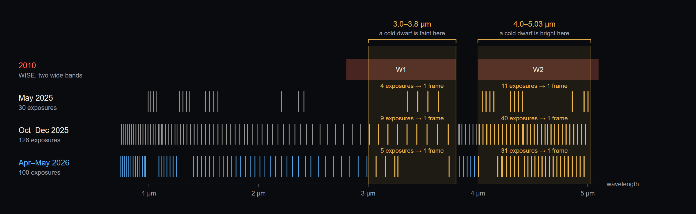
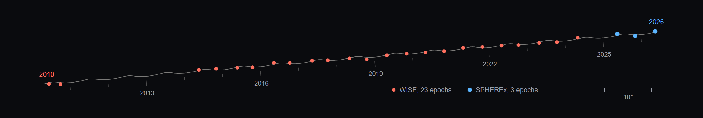
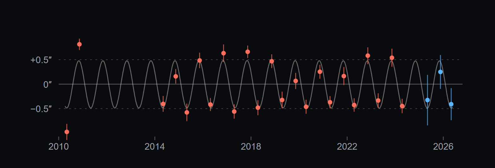
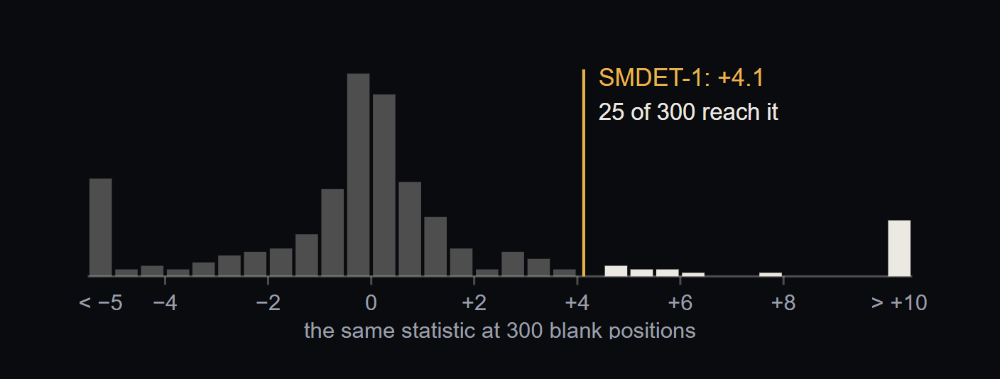
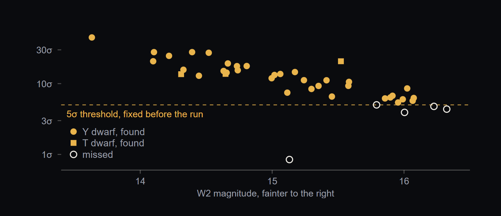
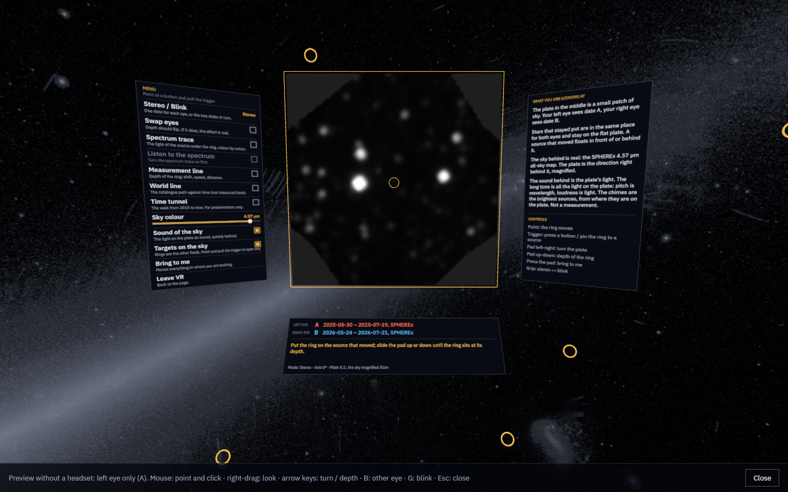

# Ektos
 
A blink and stereo comparator for the SPHEREx infrared sky.
NASA Space Apps Challenge 2026, "Planet X and SPHEREx". Team Ektos.

You give a sky coordinate. Ektos shows that patch of sky on different dates: as a blink, a movie, a
difference image, a sum, a red-cyan pair, or a real stereo pair in a VR headset. Anything that
moved or changed between two dates stands out.

SPHEREx sees every point of the sky at a different wavelength in every exposure, so its archive has
no two frames that can be blinked directly. Ektos reads only the bytes it needs from the public
archive, builds comparable frames from a wavelength window you choose, adds the 2010 WISE sky for a
16-year baseline, separates cold objects from field stars by color, and repeats every measurement
on a control.



Slides: [assets/presentation.pdf](assets/presentation.pdf)

## Contents

1. [Quick start](#quick-start)
2. [What the tool does](#what-the-tool-does)
3. [Challenge checklist](#challenge-checklist)
4. [What is new](#what-is-new)
5. [Method and mathematics](#method-and-mathematics)
6. [Measured results](#measured-results)
7. [Limits](#limits)
8. [Next steps](#next-steps)
9. [Research background](#research-background)
10. [Repository layout](#repository-layout)
11. [Data, credits, license](#data-credits-license)

## Quick start

You need 64-bit Python 3.11 or newer. The install is about 60 MB.

```bash
python -m venv .venv
.venv/Scripts/python -m pip install -r requirements.txt
.venv/Scripts/python -m ektos.server
```

Then open http://127.0.0.1:8765/. On macOS and Linux use `.venv/bin/python`. On Windows you can
also double-click `start.bat`.

The fields in `web/data/` are ready packages, and `web/` is a static site on its own. Browsers do
not load modules from `file://`, so serve it with any static server:

```bash
python -m http.server -d web 8765
```

The static site opens every ready field. Typing a new coordinate and the 8.3′ wide window need the
local engine. For a new coordinate the engine first counts the exposures, shows the download size,
and downloads only after you confirm.

Set `EKTOS_OFFLINE=1` to forbid all network access. Cached data is used and a missing file stops
the command.

Tests (no network needed):

```bash
.venv/Scripts/python -m unittest discover -s tests
node --test tests/engine.test.mjs
```

## What the tool does

| Feature | What it does |
|---|---|
| Blink | Switches between two dates |
| Movie | Plays all dates in order on one brightness scale |
| Difference | Red is light only in date A, blue is light only in date B |
| Sum | All dates together, for the faintest sources |
| Stereo | Red-cyan glasses, side by side, or a VR headset |
| Wavelength window | Drag it between 0.75 and 5.0 µm; the map shows which exposures are stacked |
| Spectrum | The spectrum of a clicked point, from all exposures |
| Cold filter | Removes ordinary stars from the 4-5 µm frame by their color |
| WISE 2010 | The AllWISE atlas frame on the same grid, as one more date |
| Markers | Gaia DR3 stars moved to the date on screen; the catalog path of the target |
| Measurement | Position on both dates, shift and speed of a clicked source |
| Field of view | 1′ to 5′ at once; 8.3′ is fetched again by the local engine |
| Injection test | Adds a source of known flux and shift to real exposures and scores who finds it (`?exp=1`) |
| Sensitivity limit | The faintest injected source that the machine observer finds at least 90% of the time |
| Blind test | Does the cold filter flag known cold dwarfs without being told where they are? |
| Engine check | `parity.html` compares the Python engine with the browser engine, number by number |
| Listen | Turns a spectrum into sound: short wavelengths high, long wavelengths low |
| Pages | `how.html` (the method, animated), `math.html` (every calculation), `sim.html` (orbits and light), `data.html` (which data is used where) |
| VR scene | The real SPHEREx sky behind the plate, a menu, spectrum trace, measurement line, world line, time tunnel; also a preview without a headset |
| Provenance | Exposure count, release, DOI and archive link for every frame |

Open by link: `?t=wise0855&band=W2s&a=0&b=3&mode=diff` opens a ready field.
`?ra=133.7951&dec=-7.2451` opens the field that covers that position. Other parameters:
`lam=4.0-5.0`, `mode=blink|stereo|diff|sum`, `cold=1`, `neg=1`, `fov=2`, `exp=1`, `vr=preview`,
`embed=1` (plate only, for an iframe).

Command line:

```bash
python -m ektos.cli count --ra 162.3288 --dec -53.3194
python -m ektos.cli build wise0855
python -m ektos.analysis wise0855
python -m ektos.analysis smdet1 candidate
python -m ektos.variable rdra
python -m ektos.inject wise0855 --a 1 --b 2 --reps 10
python -m ektos.benchmark
python -m ektos.parity wise0855
```

## Challenge checklist

| Asked in the challenge | Status |
|---|---|
| Enter a coordinate, show the image series like a video | Done |
| Five test targets | Done; one open problem on Barnard's Star (see Limits) |
| Easy update when new data arrives | Done: the file list comes live from the archive on every query |
| 102 bands, detector sums | Done: free wavelength window and D1-D6 presets |
| Instant spectrum | Done |
| Add and subtract images | Done |
| Choose the field of view | Done: 1′-5′ at once, 8.3′ with the local engine |
| Gaia and WISE overlay | Done |
| Coordinate by URL, embedding | Done |
| Metadata, contamination flags | Partly: provenance and a saturation warning; no FLAGS layer yet |
| Astropy, Aladin | Astropy is used; Aladin is not |

## What is new

Other open projects for this challenge already do blink, difference, spectrum and a Gaia overlay.
Ektos adds:

- **Reading the archive directly.** The cutout service sends a 3.86 MB PSF table with every small
  cutout. Ektos reads the header and only the pixel rows it needs from the public S3 bucket by byte
  range: about 80 kB per exposure.
- **Frame synthesis.** A point is seen at a different wavelength in every exposure. Frames are
  built from the wavelength window you choose, so both blink frames have the same color.
- **The WISE bridge.** The 2010 image and the 2010-2024 single-exposure astrometry join SPHEREx:
  a 16-year baseline, proper motion and parallax.
- **Separation by color.** A cold object is told apart from the star it sits on, and from crowding
  noise, by its color.
- **Stereo.** Date A for the left eye, date B for the right. This is Carl Pulfrich's stereo
  comparator of 1901, the instrument that came before the blink comparator.
- **Controls.** Every result is repeated at blank positions or on control stars.
- **An injection test.** The same list of trials with known answers goes to a human and to a
  machine observer.
- **Two engines.** The calculation in the browser is compared with the one in Python.

## Method and mathematics



The numbered steps follow the data from the archive to a result. `web/math.html` shows the same
steps with figures you can move.

### 1. Reading the archive

An IRSA SIA2 query lists every image that covers a position. The `IMAGE` extension of each file is
uncompressed float32, so pixels can be addressed by byte offset. For a window of half-width $`h`$
pixels ($`n = 2h + 1`$ rows of $`4n`$ bytes), with header size $`H`$ and request overhead $`o`$, the cost of
$`N`$ exposures is

```math
B \approx N\,[\,H + o + n\,(4n + o)\,], \qquad n = 2h + 1 .
```

For 358 exposures of a 5′ field this is about 29 MB. The cutout service needs
358 × 3.95 MB ≈ 1.4 GB for the same pixels.

### 2. From sky to plate

A point $`(\alpha, \delta)`$ is projected on the tangent plane at the field center
$`(\alpha_0, \delta_0)`$, with $`\Delta\alpha = \alpha - \alpha_0`$:

```math
\xi = \frac{\cos\delta\,\sin\Delta\alpha}{\cos c}, \qquad
\eta = \frac{\cos\delta_0 \sin\delta - \sin\delta_0 \cos\delta \cos\Delta\alpha}{\cos c}, \qquad
\cos c = \sin\delta_0 \sin\delta + \cos\delta_0 \cos\delta \cos\Delta\alpha .
```

### 3. Sky level and noise of one exposure

The sky level is the median $`m`$ of the pixel values $`v`$. The noise comes from the median absolute
deviation, which stars do not pull:

```math
m = \mathrm{med}(v), \qquad \sigma = 1.4826 \cdot \mathrm{med}\,|v - m| .
```

The factor is $`1/\Phi^{-1}(3/4) = 1/0.6745`$: for a Gaussian the median absolute deviation is
$`0.6745\,\sigma`$. Pixels with $`|v - m| > 3\sigma`$ are left out and the two numbers are computed
again.

### 4. One common grid

Each exposure has its own affine map between pixels and the plate,
$`(\xi, \eta)^{T} = M\,(x, y)^{T} + c`$. For every grid point we invert it and take the bilinear
value of the four pixels around $`(x, y)`$, with fractions $`f_x, f_y`$:

```math
v = (1-f_x)(1-f_y)\,v_{00} + f_x(1-f_y)\,v_{10} + (1-f_x)f_y\,v_{01} + f_x f_y\,v_{11} .
```

### 5. Stacking

The exposures inside the wavelength window are averaged with weights $`w_i = 1/\sigma_i^2`$:

```math
\bar{x} = \frac{\sum_i w_i x_i}{\sum_i w_i}, \qquad \sigma_{\bar{x}} = \Big(\sum_i w_i\Big)^{-1/2} .
```

Why these weights: for any weights $`a_i`$ with $`\sum_i a_i = 1`$ the variance of the mean is
$`\sum_i a_i^2 \sigma_i^2`$. Setting the derivative of
$`\sum_i a_i^2\sigma_i^2 - \lambda(\sum_i a_i - 1)`$ to zero gives $`2a_i\sigma_i^2 = \lambda`$, so
$`a_i \propto 1/\sigma_i^2`$, and the smallest possible variance is $`1/\sum_i w_i`$. With equal noise
this is the usual $`\sigma/\sqrt{N}`$. A pixel value is dropped from a stack of three or more when
$`|x_i - \mathrm{med}(x)| > \max(8\sigma_i,\ 2\,|\mathrm{med}(x)|)`$. Gaps longer than 60
days separate the visits.

### 6. Flux of a point source

Around a source the pixels are modeled as the PSF $`P_i`$ times a flux $`F`$ plus a flat sky $`S`$,
$`d_i \simeq F\,P_i + S`$, with a Gaussian PSF $`P_i = \frac{1}{2\pi s^2}\exp(-r_i^2/2s^2)`$.
Minimizing $`\sum_i (d_i - F P_i - S)^2`$ over $`F`$ and $`S`$ gives two linear equations, and their
solution is

```math
F = \frac{n\sum P_i d_i - \sum P_i \sum d_i}{n\sum P_i^2 - \big(\sum P_i\big)^2}, \qquad
\sigma_F = \sigma\,\sqrt{\frac{n}{n\sum P_i^2 - \big(\sum P_i\big)^2}} .
```

Units: $`F[\mu\mathrm{Jy}] = F[\mathrm{MJy/sr}] \times \Omega / (4.2545\times10^{10}) \times 10^{12}`$,
where $`\Omega`$ is the pixel area in arcsec². For a candidate test the target, all nearby catalog
sources and the sky are fitted together in every exposure.

### 7. Position of a source

The position comes from a fit of a round Gaussian plus a flat sky,

```math
G_i = A \exp\!\Big(-\frac{(x_i-x_0)^2 + (y_i-y_0)^2}{2s^2}\Big) + B, \qquad
\chi^2 = \sum_i \Big(\frac{G_i - z_i}{\sigma_i}\Big)^2 \to \min .
```

The start point is a weighted centroid with a Gaussian window $`g_i`$ of the same width, iterated as

```math
\Delta x = 2\,\frac{\sum_i g_i z_i (x_i - x_c)}{\sum_i g_i z_i}, \qquad x_c \leftarrow x_c + \Delta x .
```

The factor 2 is there because the product of the source and a window of the same width peaks
halfway between them. If the scatter of the pixels is larger than the error map says, the position
error is multiplied by $`\sqrt{\chi^2/\nu}`$.

### 8. Separation by color

`W2s` is the 4.0-5.03 µm stack and `W1s` the 3.0-3.8 µm stack of the same visit. With $`k`$ the
median flux ratio of the field stars,

```math
R = W2_s - k\,W1_s, \qquad k = \underset{j}{\mathrm{med}} \frac{W2_{s,j}}{W1_{s,j}}, \qquad
\sigma_R = \sqrt{\sigma_{W2_s}^2 + k^2\,\sigma_{W1_s}^2} .
```

A star with the usual color cancels. A cold dwarf stays, because methane makes it faint in the
short band.

### 9. Motion on the sky

In every WISE visit and every SPHEREx stack the frame offset is measured from Gaia DR3 stars and
removed. The path of the object is a straight line plus the yearly parallax:

```math
\xi(t) = \xi_0 + \mu_\xi\,(t - t_0) + \varpi\,P_\alpha(t), \qquad
\eta(t) = \eta_0 + \mu_\eta\,(t - t_0) + \varpi\,P_\delta(t) .
```

The parallax factors come from the position $`(X, Y, Z)`$ of the Earth in au, relative to the
barycenter. A nearby object appears shifted by $`-\varpi\,\mathbf{r}_\oplus`$ projected on the local
east and north unit vectors $`\mathbf{e}_\alpha = (-\sin\alpha, \cos\alpha, 0)`$ and
$`\mathbf{e}_\delta = (-\sin\delta\cos\alpha, -\sin\delta\sin\alpha, \cos\delta)`$, so

```math
P_\alpha = X\sin\alpha - Y\cos\alpha, \qquad
P_\delta = X\cos\alpha\sin\delta + Y\sin\alpha\sin\delta - Z\cos\delta .
```

The model is linear in $`p = (\xi_0, \eta_0, \mu_\xi, \mu_\eta, \varpi)`$. With the design matrix $`A`$,
the weights $`W = \mathrm{diag}(1/\sigma_i^2)`$ and the measured coordinates $`y`$:

```math
\hat{p} = (A^{T} W A)^{-1} A^{T} W y, \qquad
\sigma_p = \sqrt{\mathrm{diag}\big[(A^{T} W A)^{-1}\big]\cdot\max\big(1, \chi^2/\nu\big)}, \qquad \nu = 2n - 5 .
```

WISE detections of the target are selected by proper motion only. Parallax plays no part in the
selection.

### 10. Distance and speed

```math
d\,[\mathrm{pc}] = \frac{1}{\varpi\,['']}, \qquad v_t\,[\mathrm{km/s}] = 4.74\,\mu\,['' /\mathrm{yr}]\;d\,[\mathrm{pc}] .
```

The first is the definition of the parsec. For the second, 1″ per year at 1 pc is 1 au per year,
and $`1.496\times10^{8}\ \mathrm{km} / 3.156\times10^{7}\ \mathrm{s} = 4.74`$ km/s.

### 11. Is it real? Controls

To remove crowding, the flux in a long band is corrected with the flux in the 2.4-3.8 µm band:
$`E = F - c\,F_{\mathrm{ref}}`$, where $`c`$ is the median slope between pairs of blank positions. The
excesses $`E_b`$ in the bands $`b`$ are combined with a Y dwarf template $`T_b`$:

```math
S = \frac{\sum_b T_b E_b / \sigma_b^2}{\sqrt{\sum_b T_b^2 / \sigma_b^2}}, \qquad p = \frac{n + 1}{N + 1} .
```

The same statistic is measured at $`N`$ blank positions, and $`n`$ of them reach the value at the
target. The target counts as one more draw, so $`p`$ can never be zero with a finite number of
controls. The measurement is also repeated at the mirror positions of the neighbor stars.

### 12. A light curve from a survey that never repeats a wavelength

For a variable star the color and the time are separated:

```math
\ln F(\lambda, t) = s(\lambda) + a(t), \qquad \sum_k a(t_k) = 0, \qquad \Delta m(t) = \frac{2.5}{\ln 10}\,a(t) .
```

The period $`P`$ is scanned in steps of 0.5 day with
$`\Delta m(t) \approx c_0 + c_1 \sin(2\pi t/P) + c_2 \cos(2\pi t/P)`$. If the core is saturated, the
flux is measured from the wings of the image.

### 13. Depth in the headset

A plate of width $`W`$ at distance $`D`$ shows a field of angle $`\theta`$. A shift $`\Delta`$ on the sky
between the two dates becomes a disparity $`d`$ on the plate. With eye separation $`\mathrm{IPD}`$,
similar triangles give the distance $`Z`$ at which the two lines of sight meet:

```math
Z = D\,\frac{\mathrm{IPD}}{\mathrm{IPD} - d}, \qquad d = \Delta\,\frac{W}{\theta}, \qquad
M = \frac{2\arctan(W/2D)}{\theta} .
```

$`M`$ is the magnification of the sky. The lines of sight become parallel at $`d = \mathrm{IPD}`$. With
$`W = 1.6`$ m, $`D = 2.0`$ m, $`\mathrm{IPD} = 63`$ mm and $`\theta = 5'`$ this limit is
$`\Delta = \mathrm{IPD}\cdot\theta/W = 11.8''`$, and $`M \approx 520`$.

### 14. The injection test

A point source with the PSF of the photometry is added to the real exposures of two SPHEREx
visits: at one position in visit A and a known shift away in visit B. Its flux is set from the
formal error of the stack:

```math
\sigma_F = \Big(\sum_i 1/\sigma_{F,i}^2\Big)^{-1/2}, \qquad
F_{\mathrm{inj}} = \frac{S}{N}\cdot\max\big(\sigma_F^{A}, \sigma_F^{B}\big) .
```

The machine observer smooths the difference frame over 3 × 3 pixels and divides it by its robust
scatter. A source is "found" when $`z \ge 5`$ at an injected position:

```math
z = \frac{\big|\langle B - A\rangle_{3\times3} - \mathrm{med}\big|}{1.4826\cdot\mathrm{MAD}} .
```

Hit rates $`\hat{p} = k/n`$ are reported with the Wilson interval

```math
\frac{\hat{p} + \frac{1}{2n} \pm \sqrt{\frac{\hat{p}(1-\hat{p})}{n} + \frac{1}{4n^2}}}{1 + \frac{1}{n}} .
```

### 15. A planet far from the Sun

The parallax of a body at $`r`$ au is $`\varpi = 206\,265''/r`$. At 500 au this is 412″. SPHEREx sees a
field about six months apart from opposite sides of the Sun (parallax factors −0.97, +0.92, −0.97
for WISE 0855), so the body shifts by about $`1.9 \times 412'' \approx 13'`$ between two visits. With
real orbits the simulation page gives 13.8′-16.0′. This is wider than the 5′ plate and the 8.3′
window. It is a calculation; no such search was run.

## Measured results

Data: SPHEREx DR1 and QR3, WISE and NEOWISE single-exposure catalogs, Gaia DR3.
Measured on 14 and 15 November 2026.

### Data access

| Test | Result |
|---|---|
| Pixels read from S3 against the official IRSA cutout | Identical to the bit |
| Wavelength table, six detectors | Read; resolution R ≈ 39, 42, 43, 38, 112, 129 |
| Does the wavelength map change with time | No; the difference a year apart is exactly zero |
| Repeatability of field stars between visits | 0.1-0.2″ |
| Size of one Level 2 file | 65.8 MB (DR1), 61.3 MB (QR3) |
| A 5′ field with 358 exposures | About 29 MB; about 1.4 GB with the cutout service |
| Live mode, a new field with 450 exposures (Luhman 16) | Estimate 35.5 MB, measured 36.4 MB with catalogs |
| Counting only | 0.42 MB for 450 exposures; 2.3 MB for a deep-field position with 2493 |
| 8.3′ window, WISE 0855 field | 258 exposures; estimate 30.8 MB, measured 30.9 MB |

### WISE 0855−0714

The coordinate in the challenge belongs to 2010. In 2026 the object is about 130″ to the west, and a
fixed background star lies 4-8″ from its present position. The source seen at 4-5 µm is a blend of
the two; the star gives 35-50% of the light. The tool measures the 2010 → 2026 shift as
**129.5 ± 0.3″** (catalog model 128.6″).



Blind prediction: a model fitted to WISE data from 2010-2024 predicts the position in 2025-26.
Measured minus predicted, in arcseconds:

| Epoch | Star removed | Blended |
|---|---|---|
| 2025.34 | +0.16 ± 0.52, +0.27 ± 0.55 | −1.35 ± 0.53, +0.93 ± 0.56 |
| 2025.88 | −0.21 ± 0.36, −0.24 ± 0.34 | −1.90 ± 0.32, +0.65 ± 0.30 |
| 2026.33 | +0.08 ± 0.34, +0.15 ± 0.32 | −0.55 ± 0.28, +0.84 ± 0.25 |

With the star removed the positions agree within 1σ. The blended measurement is wrong by 6σ in the
worst epoch.

| Fit | μα ″/yr | μδ ″/yr | Parallax ″ | χ² / dof |
|---|---|---|---|---|
| WISE, no parallax | −8.142 ± 0.022 | +0.682 ± 0.029 | | 302 / 42 |
| WISE only (23 epochs) | −8.124 ± 0.010 | +0.685 ± 0.013 | 0.503 ± 0.041 | 64 / 41 |
| WISE + SPHEREx (23 + 3) | −8.125 ± 0.009 | +0.686 ± 0.012 | 0.502 ± 0.038 | 66 / 47 |
| Published | −8.118 ± 0.008 | +0.680 ± 0.007 | 0.439 ± 0.002 | |



The proper motion agrees within 1σ. The parallax is 1.7σ high, and WISE sets almost all of it:
adding the three SPHEREx epochs changes it by 0.002″. What SPHEREx adds here is the blind
prediction above.

Systematic error: the first half of the WISE epochs gives 0.597 ± 0.062″ and the second half
0.406 ± 0.047″. The difference is 0.191″, 2.4 times the combined noise of 0.078″. Half of the part
that noise does not explain is taken as systematic: $`\sqrt{0.191^2 - 0.078^2}/2 = 0.087''`$. The
result is **0.50 ± 0.04 (stat.) ± 0.09 (sys.)″**, about 2.0 pc (published 2.28 pc).

Spectral signature: −12 ± 6 µJy at 2.4-3.8 µm, +274 ± 11 at 3.8-4.4 µm, +514 ± 21 at 4.4-5.0 µm.
None of 150 blank positions reaches this value. At the mirror position of the neighbor star we
measure −123 µJy, so the absolute flux has a systematic error of about ±120 µJy.

### SMDET-1

Meisner et al. 2026 found this Y dwarf candidate in the Galactic plane "inconclusive" in SPHEREx
with 139 images. We used 364 exposures in four visits.

| | 3.8-4.4 µm | 4.4-5.0 µm |
|---|---|---|
| Flux at the target | +275 ± 37 µJy | +332 ± 32 µJy |
| Crowding noise, raw → color excess | 380 → 68 µJy | 333 → 75 µJy |
| Color excess of the target | +156 µJy | +257 µJy |
| Blank positions with an excess this large | 39 / 300 | 24 / 300 |



The best Y dwarf amplitude is 266 ± 65 µJy; W2 = 14.65 predicts 237 µJy. The statistic is +4.1 at
the target and −0.4, +0.0, +0.1 at three mirror positions. But 25 of 300 blank positions reach the
same value: **a chance probability of 8.6%**, (25 + 1)/(300 + 1). This is not a detection. It
replaces "inconclusive" with a number and shows that color suppresses crowding noise about 4.5
times.

### Blind test: 42 known cold dwarfs (39 Y, 3 T)

Question: does the cold filter flag the object when it is not told where it is? For every field the
cold image of each visit is averaged, smoothed over 3 × 3 pixels and divided by its robust scatter.
Every local peak at 5σ or more is an alarm. The catalog is opened only after that: a dwarf is
"found" if an alarm lies within 6.15″ (one detector pixel) of its position. The threshold and the
radius were fixed before the run.



| | 42 dwarfs | 39 Y dwarfs only |
|---|---|---|
| Found | **37 / 42** (88%; 95% interval 75-95%) | **34 / 39** (87%) |
| Control: the same test at blank positions | 333 of 8400, **4.0%** | 305 of 7800, 3.9% |
| False alarms elsewhere, per field | **4.8** (202 in 42 fields) | 4.8 |
| Fields where the dwarf is the strongest alarm | 14 of 42 | 13 of 39 |

All 17 dwarfs with W2 ≤ 15.0 are found, 26 of 27 with W2 ≤ 15.5, and 34 of 36 with W2 ≤ 16.0.

A second pass, added after the result was seen, also asks that nothing is visible at 3.0-3.8 µm.
False alarms fall from 4.8 to 0.79 per field and the dwarfs found fall from 37 to 33. This rule was
chosen after the first result and must be tested on independent fields.

### Other fields

| Field | Result | Control or caveat |
|---|---|---|
| Luhman 16 AB (opened live, never seen before) | One-year shift (−2.86″, +0.31″) at 4-5 µm; catalog model (−2.73″, +0.31″) | 12-17 times the scatter of the control stars |
| ε Indi Ba/Bb (SPHEREx only, four visits) | Shift (+5.0″, −3.8″) in 1.38 yr, model (+5.1″, −3.8″); parallax 0.276 ± 0.134″ (published 0.275″) | Only 2σ significant |
| Barnard's Star | Last two visits within 0.3″ of the Gaia model; one-year shift 10.2″ (model 10.3″) | First visit is 1.1″ off; cause unknown |
| R Draconis | Period 267 ± 5 days from 45 time bins, peak to peak 1.7 mag; published 245.6 days | 520 days of data cover only 1.95 cycles; "about 250-280 days" is the honest statement; no control star |
| RW Aurigae | Brightened by 0.22 mag below 2.4 µm from September 2025 to September 2026 | Control star: −0.01 mag |
| Luhman 16 spectrum | Water bands at 1.4, 1.9 and 2.7 µm and the CO band at 4.6 µm are clearly seen | No clear methane dip at 3.3 µm |
| WISE 0855, 8.3′ window | Same position as the 5′ package within 0.07″ | Color measured from a different set of stars |

### Injection test (machine observer only)

**The test with human observers has not been run.** The numbers below say nothing about stereo
against blinking.

Closed loop: a source injected with 275.85 µJy is measured back as 275.85 µJy in 40 of 40
exposures. Machine observer, WISE 0855 field, 4.0-5.0 µm, two visits, threshold 5σ:

| Formal S/N (mean flux) | Shift 3″ | Shift 6″ | Shift 12″ |
|---|---|---|---|
| 6 (103-114 µJy) | 0 / 10 | 0 / 10 | 1 / 9 |
| 10 (172-195 µJy) | 0 / 10 | 1 / 9 | 9 / 9 |
| 16 (275-284 µJy) | 1 / 10 | 9 / 10 | 10 / 10 |

The difference frame finds shifts of 6″ or more only at high S/N, and almost never a 3″ shift,
which is smaller than half a pixel. This is where a test with people will tell the most. On the
blank plate pair 5 candidates are above the threshold; two are the two lobes of WISE 0855 itself.
The sensitivity limit for this plate pair is 275 µJy at a 12″ shift.

### Photometry with the measured ePSF

The photometry was repeated with the EPSF extension of the cutout files. On isolated bright stars
the Gaussian and the ePSF give the same flux within 0-4%. For WISE 0855 the target flux is the same
with both (+514 ± 21 and +509 ± 20 µJy at 4.4-5.0 µm), and no blank control reaches it. The
−120 µJy offset at the mirror position did not go away with the ePSF; about half of it comes from
light of the target leaking to the mirror position, and −55 ± 19 µJy is still unexplained. For
SMDET-1 the chance probability is 8.6% with the Gaussian and 7.6% with the ePSF.

### Two engines

`web/engine.js` repeats the Python calculation in the browser. `python -m ektos.parity` writes
reference values, and `parity.html` computes them again from the same package.
**68 of 68 checks hold** on six fields.

| Field and window | What is checked | Largest relative difference |
|---|---|---|
| WISE 0855, 4.0-5.03 µm | Stack, forced photometry, grid sizes, trial list, injection, closed loop, machine observer | 7.0 × 10⁻⁸ |
| WISE 0855, parallax factors on 15 dates | The browser ephemeris against astropy | 6.2 × 10⁻⁵ |
| WISE 0855 8.3′ | Wide stack, exposures per pixel, 9 Gaussian fits | 1.8 × 10⁻⁵ |
| R Dra, 1.3-1.7 µm | Both engines drop the half-empty exposure 186 | same |
| Luhman 16, 1.0-2.0 µm | Deep stack, 9 Gaussian fits | 1.3 × 10⁻⁶ |
| SMDET-1, 4.4-5.03 µm | Crowded field, 9 Gaussian fits | 1.3 × 10⁻⁶ |
| ε Indi B, 4.0-5.03 µm | The cold filter window, 9 Gaussian fits | 6.6 × 10⁻⁶ |

The differences come from float32 storage and from two separate optimizers.

### VR



The scene opens on an HTC Vive Pro (SteamVR 2.18.4, Chrome 157). In the headset we saw the plate,
the readout panel, both controller rays, plate rotation and the eye swap. The menu, the help panel,
the sky background, the spectrum trace, the measurement line and the time tunnel were reported to
work in the headset. The newest layers (sky color, target rings on the sky, world line, listen)
were tested only in the preview. Whether a moving object separates in depth has not been checked in
the headset yet.

## Limits

What we do not claim:

- The discovery of a new object.
- A confirmation of SMDET-1.
- That SPHEREx can see Planet Nine.
- That stereo is better than blinking. The test has not been run.
- A SPHEREx-only parallax for faint objects.
- That the machine observer numbers apply to people.

Known limits:

- The blind test finds known objects on plates where they are in the center. It gives about five
  false alarms per field, and what they are (galaxies, dusty stars, residuals) was not studied.
- The sensitivity limit is valid only for that plate, those two dates, that window and a 12″
  shift. It does not rule out a region.
- Stereo is for shifts of a few arcseconds, between SPHEREx visits. The 2010 → 2026 shift of
  WISE 0855 is 43% of the plate and does not fuse; use blink and difference for it.
- The machine observer cannot be used in crowded fields.
- The error map of a stack is smaller than the measured scatter (1.3 to 23 times, by field).
  Position errors and S/N in the measurement panel come from the Gaussian fit, which scales itself
  to the local scatter.
- The PSF is a Gaussian. The FLAGS extension is not used; bad pixels are rejected statistically.
- The first visit of Barnard's Star is 1.1″ off in right ascension. The cause is unknown.
- The target table was typed in from the literature and compared with SIMBAD. For ε Indi B it holds
  the values of component A, and the model position for 2026 is 1.6″ from SIMBAD's entry for B.
- The Y dwarf packages have no Gaia markers and no WISE 2010 frame. In 34 fields away from the
  plane they hold only 2.4-5.0 µm.
- With the D1-D6 presets the two engines do not select the same exposures where detectors overlap.
- The sound of a spectrum is a way to hear measured points. It is not a measurement.
- The simulation uses mean orbits, two-body motion and blackbody light. A blackbody underpredicts
  the 4-5 µm flux of WISE 0855 by a factor of 18.6.
- The candidate tests were rerun from cached exposures on 15 November 2026. The astrometry and the
  light curve were refitted from saved epoch positions and were not rerun from raw pixels.

## Next steps

1. Finish the VR checklist in the headset, including the newest layers.
2. Run the injection test with human observers and report the hit rates of blink and stereo with
   their intervals, whatever they are.
3. Rerun the astrometry and the light curve from raw pixels.
4. Repeat the second pass of the blind test on independent fields, and classify the 202 false
   alarms.
5. Add a contamination flag layer (FLAGS).
6. Match visits over a wider field for distant Solar System bodies (13.8′-16.0′ between visits at
   500 au).
7. Use other surveys on the same grid: NEO Surveyor (its 4-5.2 µm channel covers our window) and
   deep optical images from the Rubin Observatory to reject galaxies.
8. Write the method up for a peer-reviewed journal.

## Research background

- **SPHEREx.** Launched in March 2025. 102 channels from 0.75 to 5.0 µm, 6.15″ pixels, the whole
  sky every six months. A linear variable filter gives every pixel its own wavelength. DR1 came out
  in November 2026; quick releases follow every week.
- **Meisner et al. 2026, SMDET-1** ([arXiv:2608.00046](https://arxiv.org/abs/2608.00046)). A Y dwarf
  candidate in the Galactic plane (b = +2.25°, W2 = 14.65, 1.3″ per year) that was missed for years
  because of crowding. It was inconclusive in SPHEREx.
- **Gagné et al. 2026, SPIFF** ([arXiv:2604.22012](https://arxiv.org/abs/2604.22012)). SPHEREx
  spectra of 6003 ultracool dwarfs, with proper motion but without parallax.
- **Rustamkulov et al. 2026** ([arXiv:2607.00543](https://arxiv.org/abs/2607.00543)). 37 brown
  dwarfs from L0 to Y4. For WISE 0855 only the light beyond 3.9 µm is detected reliably.
- **Kirkpatrick et al. 2024** ([ApJS 271, 55](https://arxiv.org/abs/2312.03639)). In the 20 pc
  census the ratio of counts outside and inside the Galactic plane should be about 3. It is 3.1 for
  L dwarfs, 4.0 for T dwarfs and 7.8 for Y dwarfs: Y dwarfs are missing in the plane.
- **The stereo comparator.** Carl Pulfrich, Zeiss, 1901. Max Wolf found 18 asteroids with it in two
  years. The blink comparator followed in 1904, and Clyde Tombaugh found Pluto with one in 1930.

## Repository layout

```
ektos/        Python engine
  net.py        HTTPS with a byte counter, offline mode, atomic file writes
  archive.py    image search with IRSA SIA2
  remote.py     header, wavelength table and pixel rows by byte range
  cube.py       one window per exposure, disk cache
  frames.py     sky level, resampling, stacks by visit and window
  phot.py       position by Gaussian fit, PSF photometry with neighbors
  geom.py       tangent plane, proper motion, parallax factors
  motion.py     astrometry tied to Gaia, proper motion and parallax fit
  analysis.py   target astrometry, parallax systematics, candidate test and controls
  variable.py   light curve by wavelength-time separation, period fit
  inject.py     source injection, trial list, machine observer
  benchmark.py  blind test on known cold dwarfs
  epsf.py       photometry with the measured ePSF
  parity.py     reference values for the browser engine
  catalogs.py   Gaia DR3, AllWISE images, WISE single-exposure tables
  cutouts.py    reads IRSA cutout files from disk
  ydwarfs.py    builds the cold dwarf packages
  simbad.py     compares the target table with SIMBAD
  simdata.py    measurements for the simulation page
  targets.py    target table
  package.py, server.py, cli.py   web package, local server, command line
web/          browser tool (static site)
  index.html, app.js      the comparator
  engine.js               the browser copy of the Python calculation
  experiment.js, machine-worker.js   injection test and machine observer
  findings.js, i18n.js    findings panel, interface text
  vr.js, skysound.js, sonify.js      VR scene and sound
  how.html, math.html, sim.html, data.html, parity.html, vrtest.html
  data/                   ready packages: 7 fields, the 8.3′ package, 42 cold dwarfs
  sky/                    SPHEREx all-sky maps for the background and VR
  vendor/                 three.js and the IBM Plex Sans font
tests/        Python tests (unittest) and browser engine tests (Node)
assets/       figures for this file and the slides
```

## Data, credits, license

**Data.** SPHEREx Level 2 spectral images, DR1 (DOI 10.26131/IRSA678) and QR3
(DOI 10.26131/IRSA662); SPHEREx DR1 All-Sky Cube (DOI 10.26131/IRSA679, used only as the background
of the page and of the VR scene); AllWISE atlas images (DOI 10.26131/IRSA153); WISE and NEOWISE
single-exposure source tables; Gaia DR3. All through the NASA/IPAC Infrared Science Archive.

> This publication makes use of data products from the Spectro-Photometer for the History of the
> Universe, Epoch of Reionization and Ices Explorer (SPHEREx), which is a joint project of the Jet
> Propulsion Laboratory and the California Institute of Technology, and is funded by the National
> Aeronautics and Space Administration.

**Third party.** three.js r160 (MIT license); IBM Plex Sans (SIL Open Font License 1.1).

**Team.** Burak Akpınar, Eren Toytoğlu, Mehmet Bedirhan Çetin, Kerem Mizrak, Ali Toprak Naz,
İsmail Hakkı Yücel.

**License.** MIT, see [LICENSE](LICENSE).

**Real data only.** Every pixel comes from the NASA archive, and every number is computed from
those pixels by the code in this repository. The only synthetic sources are those of the injection
test; they exist in memory during a test and are never written to a package or a result.

**Links.**
[IRSA SPHEREx](https://irsa.ipac.caltech.edu/Missions/spherex.html) ·
[IRSA tutorials](https://caltech-ipac.github.io/irsa-tutorials/spherex/) ·
[Carl Pulfrich](https://en.wikipedia.org/wiki/Carl_Pulfrich) ·
[Space Apps 2026](https://www.spaceappschallenge.org/2026/)
